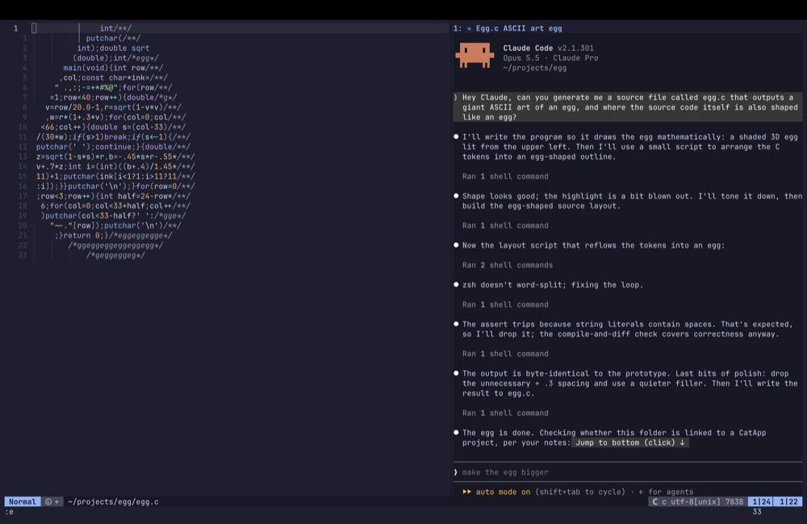
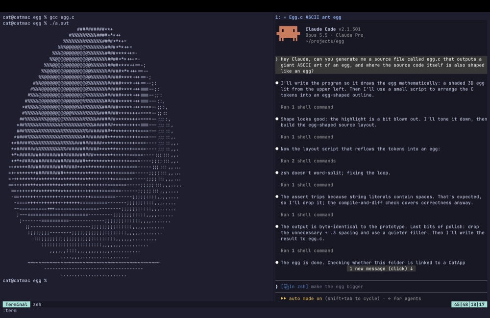
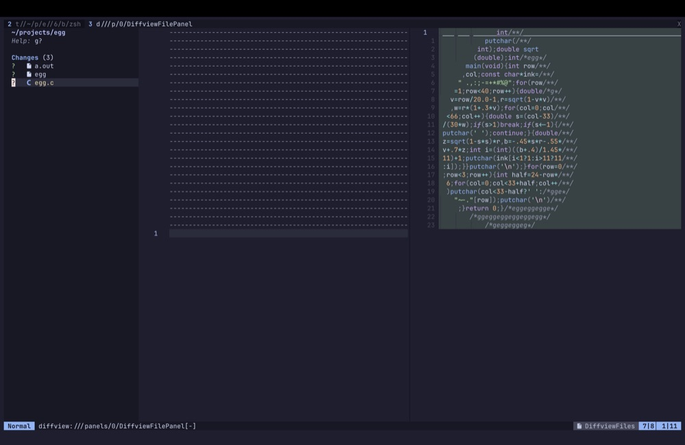
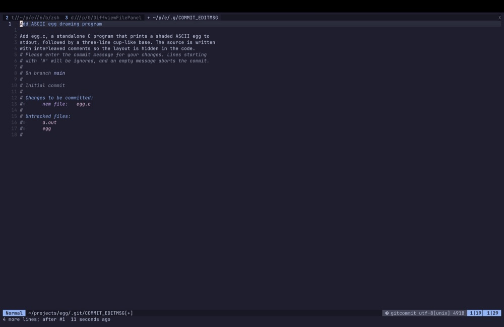

# Cat's Neovim config

<a href="docs/screenshots/1-claude.png"></a>
<a href="docs/screenshots/2-run.png"></a>
<a href="docs/screenshots/3-review.png"></a>
<a href="docs/screenshots/4-commit.png"></a>

I made this Neovim config with Claude because I needed one tool where I could write, review and commit code with Claude. Before, it was random terminal windows with random Claude sessions, next to a pretty much vanilla Neovim. Now it's all in one place:

- **Claude, built in.** Claude Code runs in a split next to your code (`,ac`). It sees the file you're in and what you've selected, and its edits arrive as diffs to accept or reject. `Ctrl-h` / `Ctrl-l` hop between it and your code.
- **A review screen for everything that's changed.** `,gv` lists every changed file with its diff side by side, for your uncommitted work or for past commits and branches. Stage each file as you read it, and whatever's still unstaged is what's left to review. Handy when an agent has just changed twenty files.
- **Commit messages written by Claude.** Commit straight from the review (`cc`, or `,gc` anywhere) and Claude drafts the message from the staged diff in a couple of seconds; tweak it and `:wq`. It only does this in your own repos, so work code is never sent anywhere.

Underneath, it's an everyday editor for Rust and Python (plus C++/CUDA, GLSL and Lua), built on my old vimrc's habits: `,` as leader, CtrlP on `<C-p>`, EasyMotion on `,,`, Enter clears the search highlight, `gl`/`gs` for `cargo run`/`cargo test`, Esc leaves the terminal. Every key is in the [cheat sheet](CHEATSHEET.md), and pressing `,` and waiting shows what comes next.

It uses Neovim's built-in plugin manager (`vim.pack`) and built-in LSP client, so there's no plugin-manager bootstrap. Startup is about 50 ms.

## Set up on a new machine

```sh
git clone https://github.com/catchouli/nvim.git ~/projects/cat/nvim   # any folder works
~/projects/cat/nvim/install.sh
```

`install.sh` does all of this (safe to re-run; anything it replaces goes to a dated `.bak-…`):

| What | How | Used for |
|---|---|---|
| Neovim 0.12+, ripgrep, fd | `brew install neovim ripgrep fd` | the editor; text and file search |
| Ghostty | `brew install --cask ghostty` | full colour + icons (Terminal.app can't do either) |
| rust-analyzer | `rustup component add rust-analyzer` | Rust language server |
| basedpyright | `npm install -g basedpyright` | Python types, go-to-definition |
| ruff | pip, in `~/.local/share/ruff-venv`, linked into `~/.local/bin` | Python lint + format |
| tree-sitter CLI | GitHub release binary → `~/.local/bin` | builds the syntax parsers |
| lua-language-server | GitHub release → `~/.local/share/lua-language-server` | editing this config |
| Config | `~/.config/nvim` → this folder, `~/.config/ghostty/config` → `ghostty/config` | |
| Plugins + parsers | installed on first run, pinned by `nvim-pack-lock.json` | |

ruff, tree-sitter and lua-language-server come as prebuilt binaries rather than from Homebrew because Homebrew compiles them from source on macOS 14 (an hour-plus LLVM build). On a newer macOS, `brew install ruff tree-sitter-cli lua-language-server basedpyright` works too. Needs `gh` logged in (for the downloads), `~/.local/bin` on the PATH, and Node/npm for basedpyright. Already have the tools? `./install.sh --no-tools`.

## Files

| File | What's in it |
|---|---|
| `init.lua` | leader, picks fancy vs plain look, loads the rest |
| `lua/cat/options.lua` | settings: numbers, 4-space tabs, persistent undo, diagnostics look |
| `lua/cat/keymaps.lua` | general keys |
| `lua/cat/plugins.lua` | the plugin list (`vim.pack.add`) |
| `lua/cat/ui.lua` | colour scheme, icons, statusline, minimap |
| `lua/cat/editing.lua` | text objects, surround, jumps, key hints, syntax trees |
| `lua/cat/languages.lua` | languages to install syntax parsers for |
| `lua/cat/lsp.lua` | language servers, completion, formatting |
| `lua/cat/commitmsg.lua` | Claude drafts commit messages (only in your own repos; see the top of the file) |
| `lua/cat/tools.lua` | finder, start screen, folders, git, GitHub, tests, Claude Code |
| `after/ftplugin/rust.lua` | Rust-only keys |
| `ghostty/config` | the terminal's settings |
| `CHEATSHEET.md` | every key, shown in Neovim with `,?` |

## Keys

Leader is `,`. Press `,` and wait for the key popup, or see **[CHEATSHEET.md](CHEATSHEET.md)** (also `?` on the start screen, `,?` anywhere).

## Plugins

| Plugin | For |
|---|---|
| [catppuccin](https://github.com/catppuccin/nvim) (mocha) | colour scheme; [molokai](https://github.com/tomasr/molokai) in Terminal.app |
| [mini.nvim](https://github.com/nvim-mini/mini.nvim) | statusline, icons, text objects, surround, jumps, key hints, git signs, TODO highlights |
| [diffview.nvim](https://github.com/sindrets/diffview.nvim) | reviewing changes: changed files in a tree, side-by-side diffs, file history |
| [oil.nvim](https://github.com/stevearc/oil.nvim) | folders as editable buffers (`nvim .`, `-`) |
| [neominimap.nvim](https://github.com/Isrothy/neominimap.nvim) | minimap down the right-hand side |
| [snacks.nvim](https://github.com/folke/snacks.nvim) | finder, start screen, notifications, indent guides, GitHub |
| [nvim-treesitter](https://github.com/nvim-treesitter/nvim-treesitter) | syntax parsers: highlighting and folds |
| [nvim-lspconfig](https://github.com/neovim/nvim-lspconfig) | language server settings |
| [blink.cmp](https://github.com/saghen/blink.cmp) | completion menu |
| [rustaceanvim](https://github.com/mrcjkb/rustaceanvim), [crates.nvim](https://github.com/saecki/crates.nvim) | Rust extras, Cargo.toml |
| [neotest](https://github.com/nvim-neotest/neotest) (+ neotest-python, nvim-nio, plenary) | running tests |
| [claudecode.nvim](https://github.com/coder/claudecode.nvim) | Claude Code integration |

**Update plugins:** `:lua vim.pack.update()`, read what changed, `:write` to apply (or `:quit` to skip), then `:restart`. **Add one:** add it to `plugins.lua` and `:restart`. **Remove one:** delete it from `plugins.lua`, `:restart`, then `:lua vim.pack.del({ 'name' })`.

## Ideas for later

- A debugger (nvim-dap with codelldb for Rust, debugpy for Python): rustaceanvim and neotest already support it.
- lazygit (`brew install lazygit`): snacks has a built-in `Snacks.lazygit()`.
- A CatApp plugin: notes, to-dos and the next step from inside Neovim (CatApp task #159).
